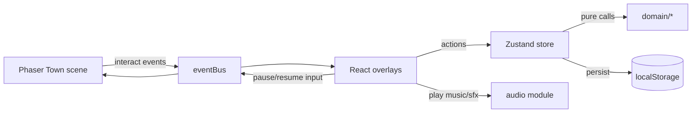

# Life Quest: Build Prompt (P0)

## 0. Your role
You are building the **P0** of *Life Quest*, a mobile-first, installable web game (PWA) that looks and feels like Pokémon FireRed (GBA-era 16×16 pixel art, top-down tile world, text boxes at the bottom of the screen, cozy chiptune music). In the game, the player's **real-life goals are side quests**. Work in `/home/ann/projects/life_rpg`. Build in the milestones in §9. After each milestone, make sure the build and tests pass, commit, and push (CI and the GitHub Pages deploy run automatically).

**Setup is already done** by a previous agent (see `SETUP_PROMPT.md`). **Read `SETUP_NOTES.md` and `public/assets/ASSETS.md` first.** The repo, tooling, dependencies, folder skeleton (with placeholder stub files), Phaser+React shell, typed eventBus skeleton, PWA config, Vitest/Playwright configs, CI/deploy workflows, and the sorted CC0 assets already exist. Don't change tooling, configs, or dependencies unless something blocks you; if you do, log the change and the reason in `SETUP_NOTES.md`. Replace placeholder stubs with real implementations.

## 1. Product vision (read carefully, it drives every decision)
- **Audience:** people in a 9-to-5 who feel exhausted, burnt out, stuck, "nothing going on". They already have a phone full of abandoned productivity apps.
- **Promise:** "Your life is the adventure. The game just keeps score."
- **The #1 failure mode is complexity.** If setup takes more than 60 seconds, or logging a quest takes more than 10 seconds, we have failed.
- **Embrace the detox irony.** The app should be quick to open, satisfying, and then tell you to close it. There is no feed and no infinite content. Copy example: *"Your quest awaits out there. Go on, I'll keep the fire warm."*
- **No guilt mechanics.** No streak resets, no punishment, no "you failed" messages. Burnt-out people uninstall apps that shame them.

## 2. Engagement design (ethical hooks)
1. **Variable reward:** every completion rolls for a bonus. 15% chance of a "Critical hit! EXP ×2", 5% chance of a rare "Lucky find" message plus bonus gold.
2. **Visible progress:** an EXP bar, a level, 4 stats (Body, Mind, Spirit, Wealth), and **Days Adventured** (cumulative, it **never resets**).
3. **Badges (8, like gym badges)**, shown in the player's house: First Step (first quest), Unplugged (5 detox quests), Iron Legs (10 body quests), Sage (10 mind quests), Coin Keeper (first wealth quest), Chain Breaker (finish any chain), Regular (7 Days Adventured), Wanderer (30 Days Adventured).
4. **Return bonus instead of streaks:** if the player has been away for 2+ days, the Innkeeper says *"You rested for 4 days. You feel refreshed!"* and gives a small EXP gift. Coming back always feels good.
5. **Small daily choice:** the Quest Board offers **3 suggestions per day** (deterministic per date, weighted by the player's chosen focus, 1 free reroll per day).
6. **Juice and atmosphere:** typewriter text, an animated EXP bar, a level-up jingle, "BODY rose by 1!" popups, a looping cozy town theme. The moment of completing a quest must feel great.

## 3. Tech stack (already installed by setup; reference only)
- **Vite + React 18 + TypeScript (strict)**
- **Phaser 3** (latest 3.x) renders the world only: tile map, player, NPCs, movement. Use `pixelArt: true` and integer scaling.
- **React** renders all UI overlays (dialog boxes, menus, quest log, forms) on top of the canvas. Style them like FireRed: white boxes with thick rounded borders, a self-hosted pixel font (`Pixelify Sans` or `Press Start 2P`), and a ▶ cursor.
- **Audio:** use **Howler.js** (or the Phaser sound manager) behind a small `audio/` module that both React and Phaser can call. Music and SFX have separate volumes. Audio unlocks on the first user tap, because browsers block autoplay.
- **Zustand** + `persist` (localStorage). Version the persisted schema and include a `migrate` function.
- **vite-plugin-pwa** for the manifest, service worker, offline support (including cached audio), and installability.
- **Vitest** for unit tests. **Playwright** for one mobile-viewport smoke test.
- **Tiled** JSON maps (`.tmj`) loaded by Phaser. If authoring in Tiled isn't possible, generate the map JSON in code, but keep it in Tiled format.
- No backend. No accounts. No analytics.
- **Hosting:** GitHub Pages via a GitHub Actions workflow. Set the Vite `base` path correctly.
- Future (do NOT build): Capacitor wrap for Android/iOS. Keep the code free of browser-only hacks that would block it.

## 4. Architecture
```
src/
  domain/            # PURE TS, no React/Phaser imports, 100% unit-tested
    types.ts         # Quest, QuestTemplate, Chain, Player, Stats, LogEntry, Badge
    xp.ts            # xpForLevel, applyXp, level-up detection
    rewards.ts       # rollBonus(rng), stat gains
    daily.ts         # pickDailySuggestions(date, prefs, library, seed)
    chains.ts        # step unlocking, custom chain creation
    badges.ts        # evaluateBadges(state) -> newly earned
    returnBonus.ts   # computeReturnBonus(lastSeen, now)
    importExport.ts  # validate + merge save files and quest packs
    rng.ts           # seeded RNG (mulberry32), injectable for tests
  data/
    questLibrary.ts  # ~40 curated templates (see §7)
    chainTemplates.ts# generic epic chains for everyone
  store/gameStore.ts # Zustand store; actions call domain functions
  game/              # Phaser
    PhaserGame.tsx, scenes/Boot.ts, scenes/Town.ts
    systems/gridMovement.ts, systems/pathfinding.ts (BFS on the collision layer)
    eventBus.ts      # typed emitter between Phaser and React
  audio/audio.ts     # playMusic(track), playSfx(name), setVolumes, unlock
  ui/
    DialogBox, Menu, QuestBoard, QuestLog, AddQuestForm, AddChainForm,
    HouseScreen (stats, badges, history), InnScreen (welcome back, settings, export/import),
    Onboarding, Hud (level + EXP bar + music toggle), DPad
public/assets/       # CC0 tiles, sprites, music, sfx + CREDITS.md
seeds/ann.json       # personal quest pack (see §7), importable via the Inn
```
**Rules:**
- Phaser and React talk only through `eventBus`, for example `interact:{building}` from Phaser to React, and `ui:open` / `ui:close` from React to Phaser to pause input.
- All game rules live in `domain/` and are deterministic, with the RNG injected.



## 5. Data model (starting point)
```ts
type Category = 'detox' | 'body' | 'mind' | 'wealth' | 'personal';
type StatKey = 'body' | 'mind' | 'spirit' | 'wealth';
type Recurrence = 'once' | 'daily' | 'weekly';
type Difficulty = 1 | 2 | 3;          // EXP 15 / 30 / 60

interface QuestTemplate { id: string; title: string; description?: string; category: Category;
  difficulty: Difficulty; recurrence: Recurrence; stats: Partial<Record<StatKey, number>>;
  flavor?: string; }            // one RPG-flavored line, e.g. "The wall stares back."

interface Quest extends QuestTemplate { instanceId: string; source: 'library' | 'custom' | 'chain' | 'pack';
  chainId?: string; chainStep?: number; status: 'active' | 'done' | 'archived';
  acceptedAt: string; completions: { at: string; note?: string }[]; }

interface Chain { id: string; title: string; description?: string; steps: QuestTemplate[];
  currentStep: number; status: 'active' | 'done'; source: 'template' | 'custom' | 'pack'; }

interface QuestPack { packVersion: 1; name: string; quests: QuestTemplate[]; chains: Omit<Chain,'currentStep'|'status'>[]; }

interface Player { name: string; sprite: 0 | 1 | 2 | 3; level: number; xp: number;
  stats: Record<StatKey, number>; gold: number; daysAdventured: string[]; // ISO dates
  badges: string[]; prefs: { mood?: string; focus: Category[] };
  lastSeen: string; musicVolume: number; sfxVolume: number; dailyRerollUsedOn?: string; }
```
- **Level curve:** `xpForLevel(n) = 50 * n * (n + 1) / 2`. The first level-up must happen on day 1, within 2 to 3 quests.
- **Recurring quests:** a daily or weekly quest can be completed once per period. After that it shows "Done for today ✓" and resets automatically.
- **Chains:** only the current step is active. Completing it unlocks the next one with *"A new path opens…"*.
- **Gold:** earned per quest (5 × difficulty). P0 only displays it. The shop comes in P1.
- **Import:** the Inn accepts two kinds of file:
  - a full **save file**, which replaces the current save after a confirmation;
  - a **QuestPack**, which merges in by adding quests and chains without touching progress.

## 6. P0 scope
### In
1. **Onboarding (≤ 60 s)**, done as dialog with the mentor NPC "Professor Rowan", with its own gentle music track:
   name → choose 1 of 4 sprites → *"How have you been feeling lately?"* (Exhausted / Stuck / Restless / Doing OK) → *"What would you like more of?"* (multi-select: Calm, Health, Growth, Money) → the game auto-accepts 3 fitting starter quests → *"Is there a big adventure on your mind?"* offers the epic templates or "Write my own" (which can also be skipped) → drops the player in town as the town theme starts.
2. **Town map:** one small map, roughly 30×20 tiles at 16 px, with grid-based 4-direction movement like FireRed.
   - Desktop: arrows / WASD, with Space/Enter as "A".
   - Mobile: **tap a tile or building to walk there** (BFS pathfinding), plus an optional D-pad and A button.
   - **Quest Board** (plaza sign): today's 3 suggestions, 1 reroll, "Write your own quest", "Start an epic quest".
   - **Your House**: stats, level, badges, Days Adventured, completed-quest history.
   - **Inn**: welcome-back bonus, settings (music/SFX volume, rename), export save, import save or quest pack, reset game.
   - **Locked road east** with the sign *"The Long Road (coming soon)"*. This teases P1.
   - 2 or 3 decorative NPCs with one-line tips (e.g. *"Boredom is where ideas hatch."*).
3. **Quest Log** (always reachable from a HUD button, so you never have to walk to log a quest): tabs Active / Epics / Done. Each quest card has a **Done** button → optional one-line reflection → reward sequence.
4. **Create custom quests and chains:**
   - Quest: only the title is required. Category, difficulty, and recurrence are optional with defaults. One screen.
   - Chain: a title plus 2 to 10 step titles, entered on one screen with "+ add step".
5. **Reward sequence:** "{name} completed {quest}!" → completion SFX → bonus roll → "+30 EXP" with the bar animating → stat popups → level-up jingle (the music ducks under it) and badge messages if earned → closing line nudging the player to put the phone down.
6. **Return bonus, Days Adventured, and badges**, as in §2.
7. **Audio:**
   - Music: town theme (looping), onboarding/mentor theme, level-up and badge jingles.
   - SFX: text blip, select, cancel, quest complete, footstep (subtle).
   - All tracks CC0 (the Ninja Adventure pack includes music and SFX). Use a short crossfade between tracks. Audio starts on the first tap.
   - Music and SFX each get their own toggle in the HUD/Inn, and both settings are saved.
   - Pause the music when the tab is hidden (`visibilitychange`).
8. **PWA:** installable on Android Chrome and works offline. Portrait mobile first, but it must also look fine on desktop (centered and letterboxed).

### Out (do NOT build)
Accounts, sync, backend, notifications, AI suggestions, shop/inventory/cosmetics, step counter/GPS, multiple maps, combat, social features.

## 7. Content
### Built-in quest library (for everyone, ~40; polish the wording)
**Detox:** Coffee or tea with no phone · A walk in the park with no headphones · Stare at a wall for 20 minutes · Screen-free evening after 8pm · Screen-free day (difficulty 3) · Phone in another room for 1 hour · Read 20 pages of a paper book · Watch the sunset · Delete one app you mindlessly scroll · Write a letter or postcard by hand.
**Body:** 10-minute walk · 30-minute walk · 10 push-ups (or knee push-ups) · 15-minute stretch · Take the stairs all day · Drink 2 L of water · Cook a real meal · Sleep before 23:00 · Try a beginner yoga video (then put the screen away).
**Mind:** Journal 3 lines · 10-minute meditation · Learn one new word in another language · Visit a place you've never been in your city · Call a friend or relative · Do something creative for 20 min · Make a "done list" of things you did today.
**Wealth:** Check your bank balance without judgment · Track every expense for 1 day · Cancel one unused subscription · Set a savings goal · Move €10 to savings · Read one article about index funds · Open a savings or investment account · **Automate €10/month to savings (difficulty 3, "the pro move")** · Increase your automation by €5.

### Generic epic chain templates (for everyone)
- **Gold Pouch:** track spending for 7 days → cancel one subscription → open a savings/investment account → automate €10/month → after 1 month, raise it by €5.
- **The Long Walk** (for a pilgrimage, hike, or charity walk): 5 km walk → 10 km walk → get proper walking shoes → 15 km with a backpack → break the shoes in on 3 walks → 20 km walk → two consecutive long days → plan the route → book the first night.
- **Career Growth:** define what "next level" means for you → list your wins from the last 6 months → ask your manager what the next level requires → pick one visible project → ask for feedback in 1 month → have the promotion/raise conversation.
- **Study Program:** pick the program/course → set a weekly study slot → first study session → finish the first module → hand in the first assignment → pass the first exam.

### Personal quest pack: `seeds/ann.json` (NOT bundled as a default; imported manually via the Inn)
A `QuestPack` named "Ann's Adventures" containing:
- Chain **Road to Santiago**: 5 km walk → 10 km walk → buy proper walking boots → 15 km with backpack → break in boots on 3 walks → 20 km walk → two consecutive 15 km days → plan Camino stages → book first albergue → *Buen Camino!*
- Chain **Get Promoted**: the Career Growth steps, personalized.
- Quest **Master's study session (1 h)**: weekly, mind +2, category personal.

## 8. Look & feel
- Use the CC0 **Ninja Adventure** asset pack (pixel-boy, itch.io) for tiles, characters, music, and SFX. Record the source in `public/assets/CREDITS.md`. Never use Nintendo assets.
- The palette should be warm, cozy, and GBA-like. Render at a 240×160 base resolution or a portrait equivalent (e.g. 160×240), with integer upscaling.
- Text appears with a typewriter effect, and a tap skips or advances it. The ▼ advance indicator blinks.
- Touch targets must be ≥ 44 px. Respect `prefers-reduced-motion`. The font must be readable at 16 px or larger on phones.

## 9. Milestones (commit after each; tests green)
1. **Domain & store:** all of `domain/` with tests (xp curve, level-up, bonus roll with seeded RNG, daily picks deterministic per date and weighted by focus, recurrence reset, chain unlock and custom chain creation, badges, return bonus, QuestPack validation and merge), store with persist + migrate. Replace the setup's placeholder test and stubs.
2. **UI without the world:** DialogBox, Menu, QuestLog, QuestBoard, AddQuestForm, AddChainForm, House, Inn (including import/export), reward sequence, all working from a temporary debug menu.
3. **Town scene:** Phaser map, grid movement, keyboard + tap-to-walk + D-pad, building/NPC interactions wired through eventBus, input paused while UI is open.
4. **Onboarding, audio & juice:** mentor dialog flow, starter quests, epic offer, audio module with music + SFX + jingles + ducking + toggles, return bonus on load, closing nudge lines. Create `seeds/ann.json`.
5. **PWA & polish:** final icons + manifest, offline (including audio), responsive layout, full Playwright smoke test (replacing the setup's trivial one), `npm run build`, confirm the existing CI and Pages deploy are green, and update the README with how to import a quest pack.

## 10. Acceptance criteria
- A fresh player reaches town with 3 active quests in **≤ 60 s**.
- From the app opening, a quest can be completed in **≤ 3 taps** (HUD → Quest Log → Done).
- The first level-up happens by the 2nd or 3rd quest.
- The town music starts after the first interaction. Music and SFX toggles work and persist. Music pauses when the tab is hidden.
- Importing `seeds/ann.json` adds the Road to Santiago and Get Promoted chains plus the weekly study quest without resetting progress.
- Closing and reopening the app (or going offline) keeps all progress.
- Being away for 3 days and returning shows the welcome-back bonus, with no negative message anywhere.
- The app installs from Android Chrome and launches fullscreen in portrait. The GitHub Pages deploy works.
- `npm test`, `npm run build`, and the Playwright smoke test all pass.
- `domain/` has no imports from React or Phaser.

## 11. Roadmap (context only, do not build)
- **P1:** "The Long Road" as a walkable map that unlocks with chain progress, shop + cosmetics bought with gold, one gentle opt-in daily reminder, more music tracks per area, Capacitor Android build.
- **P2:** AI quest suggestions from mood + history, optional cloud sync, Health Connect step verification, friends/party quests.
